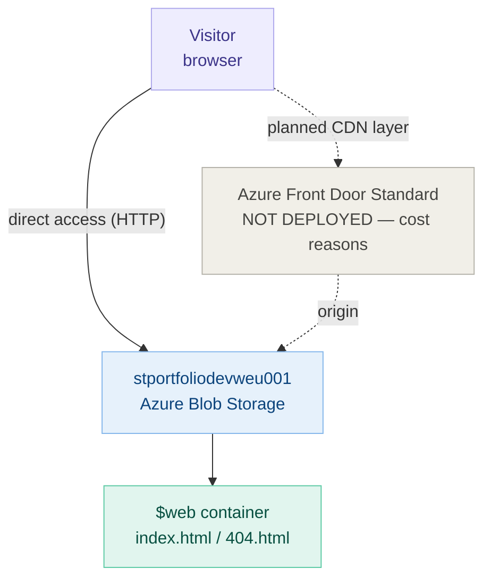

# Static Website with CDN — Project 4

## Overview
This project deploys a static portfolio website on Azure Blob Storage with static website hosting enabled.
The CDN layer (Azure Front Door) was not completed — Azure Front Door Standard has a fixed cost of ~$35/month
and is not free-tier compatible. The site remains accessible directly via the Azure Blob static hosting endpoint.

## Objectives
- Learn Azure Blob Storage static website hosting
- Understand CDN concepts (even if not deployed)
- Practice Storage Account creation and file upload via CLI
- Build a real portfolio page hosted on Azure

## Architecture



## Live URL
https://stportfoliodevweu001.z6.web.core.windows.net/

## Technologies Used
- Microsoft Azure
- Azure Blob Storage (static website hosting)
- Azure CLI

## Variables
- link: https://github.com/yourusername/AZ-P4-Static-Website/blob/main/p4-vars.sh

## Implementation Steps

- Create resource group and Storage Account:

```bash
    az group create \
      --name rg-portfolio-dev-weu-001 \
      --location westeurope \
      --tags Owner=yourname Environment=dev CostCenter=training Project=p4-portfolio

    az storage account create \
      --name stportfoliodevweu001 \
      --resource-group rg-portfolio-dev-weu-001 \
      --location westeurope \
      --sku Standard_LRS \
      --kind StorageV2 \
      --allow-blob-public-access true
```

- Enable static website hosting:

```bash
    az storage blob service-properties update \
      --account-name stportfoliodevweu001 \
      --static-website true \
      --index-document index.html \
      --404-document 404.html
```

- Upload files to the $web container:

```bash
    az storage blob upload-batch \
      --account-name $STORAGE_NAME \
      --source ./portfolio/ \
      --destination '$web' \
      --overwrite true
```

- Verify the site is live:

```bash
    curl -I $STATIC_URL
    # Expected: HTTP/1.1 200 OK
```

   + https://github.com/salvador1996/AZ-P4-Static-Website-with-AFD/blob/main/Screenshot/image-01-upload-and-verify.png

## What was NOT completed and why

### Azure Front Door (CDN layer)
- Azure CDN Standard Microsoft was retired in June 2025 — new profile creation is blocked
- The replacement (Azure Front Door Standard) costs ~$35/month fixed fee regardless of traffic
- Not free-tier compatible — resource was deleted immediately after creation to avoid charges
- CDN concepts understood: edge caching, HTTPS enforcement, origin host header, cache-control headers

## MY LEARNING JOURNEY

### 1. Azure CDN retirement

- Problem:
  The guide instructed to create an Azure CDN Standard Microsoft profile, but Azure blocked it:
  > "Azure CDN from Microsoft (classic) no longer support new profile creation."
   + https://github.com/salvador1996/AZ-P4-Static-Website-with-AFD/blob/main/Screenshot/image-02-problem-at-cdn-creation.jpg

- Resolution:
  Tried Azure Front Door Standard as the replacement, but it immediately started billing ~$35/month.
  Deleted the resource within minutes to stop charges. Documented the CDN architecture as learned
  theory without deploying it. Will revisit when a company subscription is available.
  + https://github.com/salvador1996/AZ-P4-Static-Website-with-AFD/blob/main/Screenshot/image-03-AFD-profile-creation.jpg

### 2. index.html and 404.html

- Problem:
  The guide referenced uploading index.html and 404.html without explaining where they come from.

- Resolution:
  These are plain HTML files created manually in a text editor (VS Code) and saved locally,
  then uploaded to Azure via CLI. Not generated by Azure — you write them yourself.

## What I Learned

- Azure Blob Storage can host a static website without any web server
- The $web container is a special container created automatically when static hosting is enabled
- The static website endpoint (.web.core.windows.net) is different from the blob endpoint (.blob.core.windows.net)
- curl -I checks HTTP headers only — a 200 OK confirms the file is served without showing its content
- Azure CDN classic was retired June 2025 — always check service retirement status before starting a project
- Azure Front Door Standard is NOT free-tier compatible despite Microsoft documentation suggesting otherwise

## About Me

I am an IT-Systemelektroniker trainee in Cologne aiming to become a Cloud Security Engineer by 2030.
I learn by doing production-grade Azure projects instead of watching videos or reading tutorials.
This is my fourth project. I document everything including failures and blockers — because that is
how real cloud engineers work.